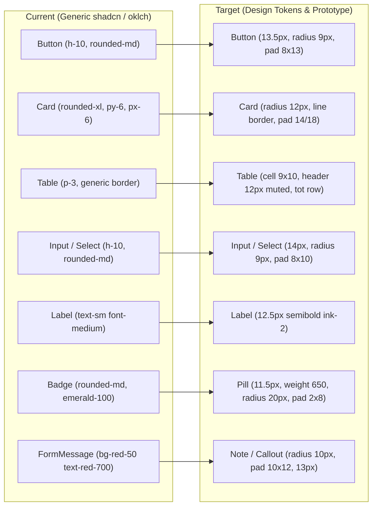
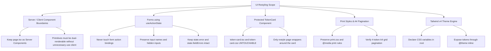
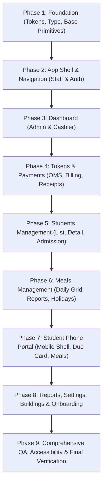

# Rangdhanu Hostel UI Restyling Plan (Phase 0: Architecture & Strategy)

This plan governs the complete UI restyling of **Rangdhanu Chatrabash** (Next.js 16 App Router, TypeScript, Tailwind v4, Drizzle + Supabase, deployed on Vercel) to match the visual prototype in `docs/design/prototype.html` and the design specifications in `docs/design/DESIGN.md`.

> [!IMPORTANT]
> **Core Constraints & Guardrails:**
>
> 1. **Visual Target Only:** We copy only the **LOOK** (design tokens, typography, component geometry, spacing, and layouts) from `docs/design/prototype.html`. All domain logic, calculations, money rules, labels, and database schemas come strictly from the real application code.
> 2. **Untouchable Boundaries:** Never modify files under `src/server/**`, `src/app/_actions/**`, `src/app/api/**`, `src/lib/validation/**`, `drizzle/**`, and the physical printed paper token components: `src/components/tokens/token-card.tsx` and `token-card.css`.
> 3. **Light Mode Only:** The entire design system is single-theme light mode (`color-scheme: light`).
> 4. **Incremental Phase Execution:** Work is executed strictly one phase at a time on dedicated feature branches (`ui/phase-N-<name>`). Each phase must pass `npm run typecheck`, `npm run lint`, `npm test`, and `npm run build`.

---

## 1. Route Inventory & Prototype Screen Mapping

Every route under `src/app` mapped to its corresponding prototype view, layout pattern, and UI components:

| Route                           | File Path                                       | Role / Access | Prototype Reference Screen                          | Visual & Component Description                                                                                                                                                                                                                                                                                                                                                                                                                                                                                                                               |
| ------------------------------- | ----------------------------------------------- | ------------- | --------------------------------------------------- | ------------------------------------------------------------------------------------------------------------------------------------------------------------------------------------------------------------------------------------------------------------------------------------------------------------------------------------------------------------------------------------------------------------------------------------------------------------------------------------------------------------------------------------------------------------ |
| `/`                             | `src/app/page.tsx`                              | All           | —                                                   | Server redirect: redirects authenticated users to their role home (`/admin`, `/cashier`, `/student`) or unauthenticated users to `/login`. No UI changes needed.                                                                                                                                                                                                                                                                                                                                                                                             |
| `/login`                        | `src/app/login/page.tsx`                        | Public        | _No prototype screen; use shared primitives_        | Clean centered single-card layout on page background (`var(--bg)`). Uses `Card` (radius 12px, line border, card shadow), `Field` with floating/subtle label and hint, `Button` primary (brand `#3340b0`, radius 9px), `FormMessage` for error callouts, and Bangla subtitle in **Hind Siliguri**.                                                                                                                                                                                                                                                            |
| `/change-password`              | `src/app/change-password/page.tsx`              | Authenticated | _No prototype screen; use shared primitives_        | Centered card identical in structure to `/login`. Clear prompt for temporary passwords, inputs with `Field`, validation hints, and primary submit button.                                                                                                                                                                                                                                                                                                                                                                                                    |
| **Admin Area**                  |                                                 |               |                                                     |                                                                                                                                                                                                                                                                                                                                                                                                                                                                                                                                                              |
| `/admin`                        | `src/app/admin/page.tsx`                        | Admin         | `viewDash()` (Admin)                                | **Admin Dashboard**: Top quick action buttons (`+ Take payment` brand button, `Today's meals`, `Students`). 4 KPI tiles in `grid g4` (`Collected today`, `Collected in month`, `Total due now` with red amount, `Student advance held`). 2-column card grid (`grid g2`): Tokens status card with `Pill` components (`ok`, `warn`, `bad`), and Month-end status card with alert icon. Occupancy table card (`tbl`) with right-aligned tabular numbers and red due amounts.                                                                                    |
| `/admin/buildings`              | `src/app/admin/buildings/page.tsx`              | Admin         | _No direct prototype screen; use shared primitives_ | `PageHeader` with title and description. Primary `Card` containing the full buildings table (`tbl`) with columns: Building code, Address, Rooms, Seats, Occupied, Vacant. "Add a building" form `Card` below with standard `Field` components and primary submit button.                                                                                                                                                                                                                                                                                     |
| `/admin/buildings/[buildingId]` | `src/app/admin/buildings/[buildingId]/page.tsx` | Admin         | _No direct prototype screen; use shared primitives_ | Building detail page: Top stat tiles (Rooms, Seats, Occupied, Vacant, Reserved). `BulkRoomsForm` card with collapsible single room form. Floor-by-floor room grid (`groupByFloor`) with visual seat chips color-coded using status tokens (Vacant = `ok`, Reserved = `warn`, Occupied = `brand-50` / `brand`).                                                                                                                                                                                                                                               |
| `/admin/students`               | `src/app/admin/students/page.tsx`               | Admin         | `viewStudents()`                                    | **Students List**: Header with student counter and `+ New student` button (`btn pri`). Inline search and filter form (search query, building, batch, status). Card with `tbl`: Student name + ID (`pill new` for new admission), Seat (`bld · room-seat`), Phone (`mono`), Rent (tabular right), Due now (tabular right: red for due, green for credit). Clickable rows with hover `surface-2`. Clean pagination footer.                                                                                                                                     |
| `/admin/students/new`           | `src/app/admin/students/new/page.tsx`           | Admin         | `MODAL.type === 'admit'`                            | **New Student Admission**: Stepper header (1. Student info, 2. Seat & rent, 3. First bill preview). Clean two-column field grid, empty-seat selector with room default rent auto-fill, and info callout (`Note info`) explaining prorata/full-month billing calculation and advance deposit.                                                                                                                                                                                                                                                                 |
| `/admin/students/[studentId]`   | `src/app/admin/students/[studentId]/page.tsx`   | Admin         | `viewStudent(id)`                                   | **Student Detail (360° View)**: Two-column grid (`grid g2`): • **Left column**: "Account" card with `DueNow` banner (red if due > 0, green if credit), advance held note, ledger balances breakdown by head, expandable "Dues by month", followed by "Bills (tokens)" list with `tokenStatus` pills. • **Right column**: "Profile" card with `<dl class="kv">` definition list (Phone in mono, Father, School, College, Batch, Admission, Rent), action buttons (Reset password, Transfer seat, Leave hostel), followed by "Payments & receipts" list. |
| `/admin/meals`                  | `src/app/admin/meals/page.tsx`                  | Admin         | `viewMeals()`                                       | **Daily Meal Grid**: Top bar with building picker and `← Prev day` / `Next day →` buttons. 3 KPI cards (`grid g3`) showing Breakfast, Lunch, Dinner "to cook" counts. Info/warning callout (`Note`) if month is locked. Large interactive grid table with 70×34px toggle buttons (`.tog.on` green, `.tog.off` red with "by student" note). Sticky bottom save bar with pending indicators.                                                                                                                                                                   |
| `/admin/meals/report`           | `src/app/admin/meals/report/page.tsx`           | Admin         | `viewReports() -> meals`                            | **Monthly Meals Overview**: Month selector and building filter. Summary KPI cards for total meals, cost, and balances. Table listing each student's B / L / D counts, total units, meal cost, and deposit comparison.                                                                                                                                                                                                                                                                                                                                        |
| `/admin/meals/holidays`         | `src/app/admin/meals/holidays/page.tsx`         | Admin         | _No direct prototype screen; use shared primitives_ | Meal holidays manager: Form to add a hostel-wide holiday (Breakfast/Lunch/Dinner/All), and table listing active/past holidays with delete actions.                                                                                                                                                                                                                                                                                                                                                                                                           |
| `/admin/payments`               | `src/app/admin/payments/page.tsx`               | Admin         | `viewPayments()`                                    | **Payments & Receipts**: Header with `+ Take payment` primary button. Top KPI grid (`grid g3`) showing monthly collection totals broken down by payment account (bKash, Nagad, Cash). "Receipts" card with newest-first receipt table, clickable to open `/receipts/[paymentId]`.                                                                                                                                                                                                                                                                            |
| `/admin/payments/new`           | `src/app/admin/payments/new/page.tsx`           | Admin         | `MODAL.type === 'pay'`                              | **Take Payment**: Student selector with live due notice (`Note warn` / `Note ok`), amount input (auto-filled with outstanding balance), payment account dropdown, TrxID input (mono), date display, and primary submit button.                                                                                                                                                                                                                                                                                                                               |
| `/admin/tokens`                 | `src/app/admin/tokens/page.tsx`                 | Admin         | `viewTokens()`                                      | **Tokens & Month-End**: Month-end run panel (`data-tour="month-end"`) with preview of meal settlements, token counts, blockers callout, and action button. Search bar for Token ID / Student ID. Table of generated tokens with student, seat, total, still unpaid, and status pill.                                                                                                                                                                                                                                                                         |
| `/admin/tokens/[code]`          | `src/app/admin/tokens/[code]/page.tsx`          | Admin         | `MODAL.type === 'token'`                            | **Single Token View**: Header with token code, status pill, and action buttons (`Print / save`, `Take payment`). Wraps the unchanged `TokenCard` paper bill inside a clean white card container.                                                                                                                                                                                                                                                                                                                                                             |
| `/admin/reports`                | `src/app/admin/reports/page.tsx`                | Admin         | `viewReports()`                                     | **Financial & Operational Reports**: Segmented tabs (`SegmentedTabs`) for: `Dues & advance`, `Collections`, `Meal settlement`, `Month summary`, and `Audit log`. Building summary table, detailed head-wise breakdown tables (rent, meal, advance), collection by day & account, and audit log table with mono timestamps. All tables include CSV export buttons.                                                                                                                                                                                            |
| `/admin/users`                  | `src/app/admin/users/page.tsx`                  | Admin         | _No direct prototype screen; use shared primitives_ | Staff management: "Add a user" form card. "All users" table card with role badges (`admin` brand, `cashier` teal), active status pills, cashier building assignment checkboxes, and inline password reset triggers.                                                                                                                                                                                                                                                                                                                                          |
| `/admin/settings`               | `src/app/admin/settings/page.tsx`               | Admin         | `viewSettings()`                                    | **Hostel Settings**: Rates card for current/future billing months (Breakfast, Lunch, Dinner, Meal deposit, Baburchi bill, Advance months, Mid-month rule, Service charge). Meal cutoff time card (night-before deadline select). Payment accounts card (table of accounts, methods, and account details).                                                                                                                                                                                                                                                    |
| `/admin/go-live`                | `src/app/admin/go-live/page.tsx`                | Admin         | _No direct prototype screen; use shared primitives_ | **Go-Live Checklist**: Month selector tabs. Checklist card with sequential steps (1. Buildings, 2. Import, 3. Rates, 4. First tokens), status indicators (CheckCircle2 in `ok`, AlertTriangle in `warn`), and direct action buttons.                                                                                                                                                                                                                                                                                                                         |
| `/admin/import`                 | `src/app/admin/import/page.tsx`                 | Admin         | _No direct prototype screen; use shared primitives_ | **Excel Student Import**: "How it works" guide card with template download button. Multi-step import wizard: file upload, validation preview table (highlighting errors in `bad` and credit in `ok`), and import commit button.                                                                                                                                                                                                                                                                                                                              |
| **Cashier Area**                |                                                 |               |                                                     |                                                                                                                                                                                                                                                                                                                                                                                                                                                                                                                                                              |
| `/cashier`                      | `src/app/cashier/page.tsx`                      | Cashier       | `viewDash()` (Cashier)                              | **Cashier Dashboard**: Header personalized ("Hello, [Name] · Cashier · [Assigned Buildings]"). Displays the same layout and KPI tiles as admin, strictly filtered to the cashier's assigned buildings.                                                                                                                                                                                                                                                                                                                                                       |
| `/cashier/students`             | `src/app/cashier/students/page.tsx`             | Cashier       | `viewStudents()`                                    | Shared `StudentsListPage` restricted to cashier's assigned buildings.                                                                                                                                                                                                                                                                                                                                                                                                                                                                                        |
| `/cashier/students/new`         | `src/app/cashier/students/new/page.tsx`         | Cashier       | `MODAL.type === 'admit'`                            | Shared `NewStudentPage` restricted to cashier's assigned buildings.                                                                                                                                                                                                                                                                                                                                                                                                                                                                                          |
| `/cashier/students/[studentId]` | `src/app/cashier/students/[studentId]/page.tsx` | Cashier       | `viewStudent(id)`                                   | Shared `StudentDetailPage` (admin-only actions like delete/void/rates hidden).                                                                                                                                                                                                                                                                                                                                                                                                                                                                               |
| `/cashier/meals`                | `src/app/cashier/meals/page.tsx`                | Cashier       | `viewMeals()`                                       | Shared `MealDayPage` for cashier's buildings.                                                                                                                                                                                                                                                                                                                                                                                                                                                                                                                |
| `/cashier/meals/report`         | `src/app/cashier/meals/report/page.tsx`         | Cashier       | `viewReports() -> meals`                            | Shared monthly meal report for cashier's buildings.                                                                                                                                                                                                                                                                                                                                                                                                                                                                                                          |
| `/cashier/payments`             | `src/app/cashier/payments/page.tsx`             | Cashier       | `viewPayments()`                                    | Shared `PaymentsListPage` for cashier's collections.                                                                                                                                                                                                                                                                                                                                                                                                                                                                                                         |
| `/cashier/payments/new`         | `src/app/cashier/payments/new/page.tsx`         | Cashier       | `MODAL.type === 'pay'`                              | Shared `TakePaymentPage` for cashier.                                                                                                                                                                                                                                                                                                                                                                                                                                                                                                                        |
| `/cashier/tokens`               | `src/app/cashier/tokens/page.tsx`               | Cashier       | `viewTokens()`                                      | Shared `TokensListPage` (month-end run execution button hidden; cashier can view and search tokens).                                                                                                                                                                                                                                                                                                                                                                                                                                                         |
| `/cashier/tokens/[code]`        | `src/app/cashier/tokens/[code]/page.tsx`        | Cashier       | `MODAL.type === 'token'`                            | Shared `SingleTokenPage`.                                                                                                                                                                                                                                                                                                                                                                                                                                                                                                                                    |
| `/cashier/reports`              | `src/app/cashier/reports/page.tsx`              | Cashier       | `viewReports()`                                     | Shared `ReportsPage` (excluding the admin-only Audit Log tab).                                                                                                                                                                                                                                                                                                                                                                                                                                                                                               |
| **Student Portal**              |                                                 |               |                                                     |                                                                                                                                                                                                                                                                                                                                                                                                                                                                                                                                                              |
| `/student`                      | `src/app/student/page.tsx`                      | Student       | `renderPhone() -> phHome(s)`                        | **Student Mobile Home**: Dedicated ~420px phone-first container. Top bar with hostel name and student subtitle. Large avatar in student color (`#c9581a`). Due card (radius 14px, padding 16px: `#fdecec`/`#7f1d1d` if due > 0, `#e8f7ed`/`#14532d` if paid). Latest bill summary card with link to paper token. "How to pay" card with bKash/Nagad details in mono. Meals summary card with quick link to meal toggles. Recent payments list. Bottom 4-tab bar.                                                                                             |
| `/student/account`              | `src/app/student/account/page.tsx`              | Student       | `phAccount(s)`                                      | **Student Account**: Due banner, advance held note, detailed ledger balances card by head, Bills (tokens) list card, and Payments & receipts list card.                                                                                                                                                                                                                                                                                                                                                                                                      |
| `/student/meals`                | `src/app/student/meals/page.tsx`                | Student       | `phMeals(s)`                                        | **Student Meals Calendar**: Info callout with deadline cutoff ("Change meals until [Hour] PM the night before"). Monthly table with dates, weekday, and 40×32px toggle cells (green ✓ for ON, red ✕ for OFF, gray for office-locked). Daily default toggle switch.                                                                                                                                                                                                                                                                                           |
| `/student/profile`              | `src/app/student/profile/page.tsx`              | Student       | `phProfile(s)`                                      | **Student Profile**: Card with `<dl class="kv">` definition list (Student ID, Building, Room/Seat, Seat rent, Phone in mono, School, College, Batch). Notice to contact office for corrections. "Change password" button.                                                                                                                                                                                                                                                                                                                                    |
| `/student/tokens/[code]`        | `src/app/student/tokens/[code]/page.tsx`        | Student       | `MODAL.type === 'token'`                            | Student's single token view. Wraps `TokenCard` in student portal container with print link.                                                                                                                                                                                                                                                                                                                                                                                                                                                                  |
| **Receipts & Print**            |                                                 |               |                                                     |                                                                                                                                                                                                                                                                                                                                                                                                                                                                                                                                                              |
| `/receipts/[paymentId]`         | `src/app/receipts/[paymentId]/page.tsx`         | Authenticated | `MODAL.type === 'receipt'`                          | **Money Receipt**: If payment has `tokenId`, wraps `TokenCard` with highlighted payment row. If standalone receipt, displays dedicated `.receipt` card with `.rt` title, receipt number in mono, `<dl class="kv">` metadata, allocation breakdown table, due before/after status, and admin Void form.                                                                                                                                                                                                                                                       |
| `/print/tokens`                 | `src/app/print/tokens/page.tsx`                 | Staff         | Prototype print sheet                               | **Print Batch Tokens**: Screen background `#f2f3f8`, print background white. `PrintBar` with token count and A4 page count. Renders 4 `TokenCard` components per A4 sheet via `.token-sheet` grid.                                                                                                                                                                                                                                                                                                                                                           |

---

## 2. UI Primitives: Current vs Target & New Primitives Needed

Per `DESIGN.md` and `prototype.html`, here is the transition plan for our UI component library:

### A. Existing Primitives to Restyle

1. **Button** (`src/components/ui/button.tsx`):
   - **Target Geometry**: Font size 13.5px semibold, padding 8×13px, radius 9px, 1px `var(--line)` border, white surface background.
   - **Variants**:
     - `default` / `outline`: white surface, line border `#e0e3ee`, text `#161a2e`, hover `var(--surface-2)`.
     - `primary`: background `var(--brand)` (`#3340b0`), border `var(--brand)`, text `#ffffff`, hover `var(--brand-600)` (`#28339a`).
     - `ok` / `success`: background `var(--ok)` (`#15803d`), border `var(--ok)`, text `#ffffff`.
     - `ghost`: no border, transparent background, hover `var(--surface-2)`.
     - `sm`: padding 5×10px, font size 12.5px, radius 8px.
     - `disabled`: 45% opacity, `cursor: not-allowed`.
     - Focus ring: `3px solid rgba(51,64,176,.45)`, offset 2px.

2. **Card** (`src/components/ui/card.tsx`):
   - **Target Geometry**: Background `var(--surface)` (`#ffffff`), border `1px solid var(--line)` (`#e0e3ee`), radius 12px, shadow `var(--shadow)` (`0 1px 2px rgba(22,26,46,.05), 0 2px 10px rgba(22,26,46,.05)`).
   - **Header (`CardHeader`)**: Padding `14px 18px 0`, flex row with space-between for title and actions.
   - **Title (`CardTitle`)**: Font size 15px, font-weight 600, color `var(--ink)` (`#161a2e`).
   - **Description (`CardDescription`)**: Font size 12.5px, color `var(--muted)` (`#666d8c`), margin-top 2px.
   - **Body (`CardContent`)**: Padding `14px 18px 18px`.

3. **Table** (`src/components/ui/table.tsx`):
   - **Target Geometry**: Full width, font size 13.5px.
   - **Header (`TableHead`)**: Font size 12px, font-weight 600, color `var(--muted)` (`#666d8c`), padding 8×10px, bottom border `1px solid var(--line)`.
   - **Cell (`TableCell`)**: Padding 9×10px, vertical align middle, divider `1px solid var(--line-2)` (`#eceef5`). Last row has no bottom border (`border-b-0`).
   - **Alignment & Numbers**: Right-aligned cells for money and counts with `tabular-nums` (`font-variant-numeric: tabular-nums`).
   - **Row Hover & Total**: Clickable rows have `cursor: pointer` and hover background `var(--surface-2)`. Total row (`TableRow.tot`) has bold font and background `var(--surface-2)`.
   - **Container**: Wrapped in horizontal overflow wrapper (`tw`).

4. **Input & Select** (`src/components/ui/input.tsx`, `src/components/ui/select.tsx`):
   - **Target Geometry**: Border `1px solid var(--line)`, radius 9px, padding 8×10px, font size 14px, background `var(--surface)`.
   - **Focus & States**: Focus ring `3px solid rgba(51,64,176,.45)`, offset 2px. Placeholder color `var(--muted)`. Disabled opacity 50%. Native select styled identically for mobile reliability.

5. **Label** (`src/components/ui/label.tsx`):
   - **Target Geometry**: Font size 12.5px, font-weight 600, color `var(--ink-2)` (`#3a405c`).

6. **Badge → Status Pill** (`src/components/ui/badge.tsx`):
   - **Target Geometry**: Pill badge with font size 11.5px, font-weight 650, padding 2×8px, radius 20px, 1px border.
   - **Semantic Variants**:
     - `ok`: background `var(--ok-bg)` (`#effbf2`), text `var(--ok)` (`#15803d`), border `var(--ok-line)` (`#bfe8cb`).
     - `warn`: background `var(--warn-bg)` (`#fff8e6`), text `var(--warn)` (`#a15c07`), border `var(--warn-line)` (`#f6dc9c`).
     - `bad`: background `var(--bad-bg)` (`#fdf1f1`), text `var(--bad)` (`#b42323`), border `var(--bad-line)` (`#f4c9c9`).
     - `gray`: background `var(--surface-3)` (`#eef0f6`), text `var(--ink-2)` (`#3a405c`), border `var(--line)` (`#e0e3ee`).
     - `new` / `brand`: background `var(--brand-50)` (`#eef0fc`), text `var(--brand)` (`#3340b0`), border `var(--brand-100)` (`#dde1fa`).

7. **FormMessage & FieldError** (`src/components/ui/form-message.tsx`):
   - Replace one-off Tailwind red/emerald styles with the new `Note` primitive (variants `bad` and `ok`).

---

### B. New UI Primitives to Introduce

1. **`KpiTile` (`src/components/ui/kpi-tile.tsx`)**:
   - Card container with padding 14×16px.
   - Label: 12.5px, color `var(--muted)`, font-weight 500.
   - Value: 25px, font-weight 700, tabular numbers, line-height 1.25. Optional tone (`red` for outstanding dues).
   - Note/Subtext: 12px, color `var(--muted)`.
   - Clickable state: cursor pointer, hover border turns `var(--brand-100)`.

2. **`Note` / Callout (`src/components/ui/note.tsx`)**:
   - Flex row container, radius 10px, padding 10×12px, font size 13px, 1px border.
   - Variants:
     - `neutral`: background `var(--surface-2)`, border `var(--line)`, text `var(--ink-2)`.
     - `info`: background `var(--brand-50)`, border `var(--brand-100)`, text `var(--ink)`.
     - `ok`: background `var(--ok-bg)`, border `var(--ok-line)`, text `var(--ok)`.
     - `warn`: background `var(--warn-bg)`, border `var(--warn-line)`, text `var(--warn)`.
     - `bad`: background `var(--bad-bg)`, border `var(--bad-line)`, text `var(--bad)`.

3. **`SegmentedTabs` (`src/components/ui/segmented-tabs.tsx`)**:
   - Container with flex-wrap gap-1 or gap-2.
   - Tab items: font size 13px, font-weight 600, padding 7×13px, radius 8px, border `1px solid var(--line)`, background `var(--surface)`, text `var(--ink-2)`.
   - Active state: background `var(--brand)`, text `#ffffff`, border-color `var(--brand)`.

4. **`KeyValueList` (`<dl class="kv">`) (`src/components/ui/key-value-list.tsx`)**:
   - Two-column grid layout: `grid-template-columns: 140px 1fr`, gap 6px 12px, font size 13.5px.
   - `<dt>`: 12.5px, font-weight 500, color `var(--muted)`.
   - `<dd>`: 13.5px, color `var(--ink)`, font-weight 400/500 (mono for IDs and phone numbers).

5. **`MealToggle` (`src/components/ui/meal-toggle.tsx`)**:
   - Staff variant: 70×34px, radius 8px, font-size 12px, font-weight 700. ON (ok), OFF (bad with "by student" subtitle).
   - Student mobile variant: 40×32px, radius 8px, font-size 13px, font-weight 700. ON (green ✓), OFF (red ✕), OFFICE (gray ✕).

6. **`DueCard` (`src/components/ui/due-card.tsx`)**:
   - Radius 14px, padding 16px.
   - Must pay: background `#fdecec`, text `#7f1d1d`.
   - All paid: background `#e8f7ed`, text `#14532d`.
   - Value: font size 32px, font-weight 700, tabular numbers.

7. **`RoleAvatar` (`src/components/ui/role-avatar.tsx`)**:
   - Circular avatar with role background: Admin `#3340b0`, Cashier `#0c7b7f`, Student `#c9581a`, System `#6b3fa0`.
   - Bold white initial letter. Sizes: 34px (sidebar who-block), 48px/64px (student portal).

---

## 3. Inventory of Hard-Coded Colors & One-Off Styles

The following table lists every instance of hard-coded colors or one-off styles across the codebase and their target design tokens:

| File Location                                        | Current Code / Classes                                                                                                                         | Issue                                           | Target Design Token / Primitive                                                                                  |
| ---------------------------------------------------- | ---------------------------------------------------------------------------------------------------------------------------------------------- | ----------------------------------------------- | ---------------------------------------------------------------------------------------------------------------- |
| `src/app/globals.css`                                | `:root { --primary: oklch(...); ... }`                                                                                                         | Default generic shadcn OKLCH values             | Replace with prototype CSS hex variables (`--bg`, `--surface`, `--ink`, `--brand`, etc.)                         |
| `src/app/layout.tsx`                                 | `Inter({ subsets: ["latin"] })`                                                                                                                | Using Inter font                                | Switch to `IBM Plex Sans` + `Hind Siliguri` + `IBM Plex Mono`                                                    |
| `src/components/ui/badge.tsx`                        | `bg-emerald-100 text-emerald-800`, `bg-red-100 text-red-800`                                                                                   | Hardcoded Tailwind color names                  | Replace with `Pill` token variants (`ok`, `bad`, `warn`, `gray`, `new`)                                          |
| `src/components/ui/form-message.tsx`                 | `bg-red-50 text-red-700`, `bg-emerald-50 text-emerald-700`                                                                                     | One-off message colors                          | Replace with `Note` primitive (`bad` / `ok`)                                                                     |
| `src/components/dashboard/dashboard-view.tsx`        | `text-red-700`, `text-amber-600`, `text-emerald-600`, `hover:border-primary/50`                                                                | Un-tokenized alert and status colors            | Use `var(--bad)` for dues, Lucide icons in `var(--warn)`/`var(--ok)`, and `KpiTile` primitive                    |
| `src/components/student-portal/parts.tsx`            | `bg-red-50 text-red-900`, `bg-emerald-50 text-emerald-900`                                                                                     | DueNow card colors do not match prototype spec  | Use `DueCard` primitive with exact prototype hexes: `#fdecec` / `#7f1d1d` (due) and `#e8f7ed` / `#14532d` (paid) |
| `src/components/student-portal/my-meals.tsx`         | `border-emerald-300 bg-emerald-50 text-emerald-800`, `border-red-200 bg-red-50 text-red-700`, `bg-amber-100 text-amber-800`                    | Inline Tailwind classes for calendar meal cells | Use `MealToggle` student variant (`var(--ok-bg)`, `var(--bad-bg)`, `var(--warn-bg)`)                             |
| `src/components/meals/meal-grid.tsx`                 | `border-red-200 bg-red-50 text-red-700`, `border-emerald-300 bg-emerald-50 text-emerald-800`, `text-amber-700`                                 | Inline toggle button colors                     | Use `.tog.on` and `.tog.off` classes wired to tokens (`var(--ok)`, `var(--bad)`)                                 |
| `src/components/payments/account-summary.tsx`        | `bg-red-50 text-red-900`, `bg-emerald-50 text-emerald-900`, `text-red-700`, `text-emerald-700`                                                 | Raw Tailwind colors for dues and credits        | Use `DueCard` or `Note` primitive with `var(--bad)` / `var(--ok)`                                                |
| `src/components/reports/report-pages.tsx`            | `text-red-700`, `text-emerald-700`                                                                                                             | Raw text colors for due and credit              | Use `var(--bad)` and `var(--ok)` token classes (`red`, `green`)                                                  |
| `src/app/receipts/[paymentId]/page.tsx`              | `bg-red-50 text-red-800`, `-rotate-12 border-4 border-red-600 text-red-600/70`                                                                 | Hardcoded red shades for void banner            | Use `Note bad` for void notice and `var(--bad)` for VOID stamp                                                   |
| `src/app/receipts/[paymentId]/receipt-actions.tsx`   | `text-red-700`                                                                                                                                 | Inline red text for void summary                | Use `var(--bad)` token                                                                                           |
| `src/components/students/leave-forms.tsx`            | `border-emerald-300 bg-emerald-50 text-emerald-900`                                                                                            | Hardcoded emerald callout                       | Replace with `Note ok`                                                                                           |
| `src/components/students/seat-picker.tsx`            | `text-amber-700`                                                                                                                               | Hardcoded amber text                            | Replace with `Note warn` or `var(--warn)`                                                                        |
| `src/components/students/student-forms.tsx`          | `bg-emerald-50 text-emerald-800`                                                                                                               | Hardcoded emerald callout                       | Replace with `Note ok`                                                                                           |
| `src/components/tokens/token-pages.tsx`              | `bg-red-50 text-red-800`, `border-amber-300 bg-amber-50 text-amber-900`, `text-emerald-700`                                                    | Blockers and preview callout colors             | Replace with `Note bad`, `Note warn`, and `Note ok`                                                              |
| `src/components/tokens/token-payment-form.tsx`       | `border-emerald-300 bg-emerald-50 text-emerald-900`                                                                                            | Success payment notification                    | Replace with `Note ok`                                                                                           |
| `src/app/admin/buildings/[buildingId]/page.tsx`      | `border-emerald-300 bg-emerald-50`, `border-amber-300 bg-amber-50`, `border-blue-300 bg-blue-50`                                               | Raw status legend chips                         | Use `Pill ok`, `Pill warn`, `Pill new` chips                                                                     |
| `src/app/admin/buildings/[buildingId]/room-card.tsx` | `border-blue-300 bg-blue-50 text-blue-800`, `border-amber-300 bg-amber-50 text-amber-800`, `border-emerald-300 bg-emerald-50 text-emerald-800` | Hardcoded seat status colors                    | Use tokens: Vacant = `ok`, Reserved = `warn`, Occupied = `brand-50` / `brand`                                    |
| `src/app/admin/go-live/page.tsx`                     | `text-emerald-600`, `text-amber-600`                                                                                                           | Hardcoded icon colors                           | Use `var(--ok)` and `var(--warn)`                                                                                |
| `src/app/admin/import/import-wizard.tsx`             | `text-red-700`, `bg-red-50`, `text-emerald-700`                                                                                                | Import error/credit table row colors            | Replace with `bad` and `ok` row highlight classes                                                                |
| `src/app/admin/users/cashier-buildings-form.tsx`     | `text-amber-700`, `text-red-600`, `text-emerald-700`                                                                                           | Form validation status colors                   | Replace with `var(--warn)`, `var(--bad)`, `var(--ok)`                                                            |
| `src/app/admin/users/reset-password-form.tsx`        | `text-red-600`, `text-emerald-700`                                                                                                             | Form result status colors                       | Replace with `var(--bad)`, `var(--ok)`                                                                           |
| `src/app/student/meals/page.tsx`                     | `text-red-700`, `text-emerald-700`                                                                                                             | Difference text colors                          | Replace with `var(--bad)` and `var(--ok)` classes                                                                |

---

## 4. Risks & Technical Constraints

1. **Server vs. Client Component Boundaries**:
   - The majority of page components (`src/app/**/page.tsx`) are Server Components that fetch data securely.
   - New and restyled primitives (`Button`, `Card`, `Table`, `KpiTile`, `Note`, `Pill`, `KeyValueList`) must remain Server-renderable (no `"use client"` directive unless client-side state, event handlers, or browser APIs are required).
   - The student portal phone container (`.phone`, `.ptop`, `.pbody`, `.ptabs`) must wrap server-rendered tab views cleanly without forcing client rendering on data-heavy pages.

2. **Forms Using `useActionState`**:
   - Over 20 critical forms utilize React 19's `useActionState` (e.g., `ActionButton`, `LoginForm`, `ChangePasswordForm`, `MealGrid`, `TokenPaymentForm`, `AdmissionForm`, `LeaveForm`, `UpdateRoomForm`, `RatesForm`, `ImportWizard`).
   - Restyling form fields and buttons must strictly preserve:
     - Form `action={formAction}` wiring.
     - Hidden inputs (e.g., entity IDs, building IDs).
     - Field `name` attributes matching server action Zod validation schemas.
     - `pending` state disables and loading labels.
     - Error displays (`state.error` and `state.fieldErrors`).

3. **Untouchable Paper Token (`token-card.tsx` and `token-card.css`)**:
   - `src/components/tokens/token-card.tsx` and `token-card.css` define the client's official printed bill format (serif typography, exact table grid lines, and physical layout).
   - Under no circumstances will `token-card.tsx` or `token-card.css` be modified.
   - Any container hosting the token (`/admin/tokens/[code]`, `/cashier/tokens/[code]`, `/student/tokens/[code]`, `/receipts/[paymentId]`, `/print/tokens`) will only restyle the outer page frame, action toolbar, and scrolling wrappers.

4. **Print Media Styles & A4 Layout Integrity**:
   - `src/app/print/tokens/print.css` handles multi-page A4 printing (4 tokens per sheet, exact 194mm width, zero margin `@page`, page breaks).
   - `/receipts/[paymentId]/page.tsx` has dedicated `@media print` rules to output a clean physical slip.
   - Global design token changes must not bleed into `@media print` or break `print:hidden` classes.

5. **Tailwind v4 `@theme` Architecture**:
   - Tailwind v4 uses CSS-first configuration via `@theme inline`.
   - All tokens must be cleanly defined as CSS variables in `:root` and registered under `@theme inline` so utility classes (`bg-surface`, `text-ink`, `border-line`, `bg-brand`, `text-ok`, `bg-brand-50`) are available throughout the app without arbitrary values.

6. **Typography & Font Subsetting**:
   - Fonts must be loaded using `next/font/google`:
     - **IBM Plex Sans**: 400, 500, 600, 700 (Latin body).
     - **Hind Siliguri**: 400, 500, 600, 700 (Bangla text).
     - **IBM Plex Mono**: 500, 600 (Numbers, Token IDs, TrxIDs, phone numbers).
   - `font-variant-numeric: tabular-nums` (`tabular-nums`) must be applied globally to numeric columns and balance displays to prevent layout jitter.

---

## 5. Execution Roadmap: Suggested Order for Phases 1 to 9

### Phase 1: Foundation (Tokens, Typography & UI Primitives)

- **Branch**: `ui/phase-1-foundation`
- **Scope**:
  1. Update `src/app/globals.css`: configure `:root` CSS variables for the exact palette (`--bg`, `--surface`, `--surface-2`, `--surface-3`, `--ink`, `--ink-2`, `--muted`, `--faint`, `--line`, `--line-2`, `--brand`, `--brand-600`, `--brand-50`, `--brand-100`, `--head`, `--ok`, `--warn`, `--bad`, role accents, radii, shadows, and focus rings).
  2. Register tokens in Tailwind v4 `@theme inline`.
  3. Update `src/app/layout.tsx`: import `IBM_Plex_Sans`, `Hind_Siliguri`, and `IBM_Plex_Mono` from `next/font/google`, wire CSS font variables, and set body defaults.
  4. Restyle existing primitives: `Button` (exact padding, radius 9px, variants), `Card` (radius 12px, line border, padding 14/18), `Input`, `Select`, `Label`, `Table` (9×10px cells, line-2 dividers, tot row), `Badge` (convert to `Pill` specification).
  5. Create new primitives: `KpiTile`, `Note`, `Pill`, `SegmentedTabs`, `KeyValueList`, `DueCard`, `RoleAvatar`.
- **Exit Gate**: `npm run typecheck`, `npm run lint`, `npm test`, `npm run build`.

### Phase 2: App Shell & Navigation

- **Branch**: `ui/phase-2-app-shell`
- **Scope**:
  1. Restyle staff desktop sidebar in `AppShell` (`src/components/layout/app-shell.tsx`, `nav-links.tsx`): 232px width, white surface, right line border, sticky full height.
  2. Implement top "who" block: role-accent avatar with initial, name 14px bold, role 11.5px muted, line-2 divider.
  3. Style nav items: 14px medium ink-2, radius 9px, hover `surface-2`; active state = `brand-50` background + `brand` text + weight 650.
  4. Implement responsive collapse: below 1180px, sidebar transforms into a clean top strip with wrapping nav items.
  5. Standardize `PageHeader`: 22px bold title, 13.5px muted description, right-aligned action toolbar.
  6. Restyle `/login` and `/change-password`: clean centered cards using the new primitives.
- **Exit Gate**: Typecheck, lint, test, build.

### Phase 3: Dashboard (Admin & Cashier)

- **Branch**: `ui/phase-3-dashboard`
- **Scope**:
  1. Restyle `src/components/dashboard/dashboard-view.tsx` used by `/admin` and `/cashier`.
  2. Top action bar with primary `+ Take payment` button, `Today's meals`, and `Students`.
  3. 4 KPI tiles in `grid g4` (`Collected today`, `Collected in month`, `Total due now` with red tabular value, `Student advance held`).
  4. 2-column card grid (`grid g2`): Tokens status overview card with `Pill` badges (`ok`, `warn`, `bad`), and Month-end status card with alert/check icon.
  5. Buildings occupancy summary table with right-aligned tabular counts and red due amounts.
- **Exit Gate**: Typecheck, lint, test, build.

### Phase 4: Tokens & Payments

- **Branch**: `ui/phase-4-tokens-payments`
- **Scope**:
  1. Restyle `/admin/tokens` and `/cashier/tokens` (`src/components/tokens/token-pages.tsx`):
     - Month-end run panel with preview table, blockers callout, and action button.
     - Token search bar (`TokenSearch`).
     - Tokens list table with status pills.
  2. Restyle `/admin/tokens/[code]` and `/cashier/tokens/[code]`: outer card wrapper, status bar, and actions around the untouched `TokenCard`.
  3. Restyle `/admin/payments` and `/cashier/payments`: payment account KPI cards (bKash, Nagad, Cash) and receipts table.
  4. Restyle `/admin/payments/new` and `/cashier/payments/new`: Take Payment form matching prototype `pay` modal (student select, live due callout, amount, payment account, TrxID in mono).
  5. Restyle `/receipts/[paymentId]` (`src/app/receipts/[paymentId]/page.tsx`): dedicated receipt card with receipt number in mono, `<dl class="kv">`, allocation breakdown table, due summary, and admin void form.
- **Exit Gate**: Typecheck, lint, test, build.

### Phase 5: Students Management

- **Branch**: `ui/phase-5-students`
- **Scope**:
  1. Restyle `/admin/students` and `/cashier/students` (`StudentsListPage`): filter search bar, student table with student ID, mono phone, seat, rent, due/credit colored cells, and `Pill new` for admissions.
  2. Restyle `/admin/students/new` and `/cashier/students/new` (`AdmissionForm`): clean multi-step form matching prototype admit stepper, free seat selector, rent default, and admission bill preview callout.
  3. Restyle `/admin/students/[studentId]` and `/cashier/students/[studentId]` (`StudentDetailPage`):
     - Left column: Account card with `DueCard` banner, advance note, ledger head breakdown, dues by month, and token history.
     - Right column: Profile card with `<dl class="kv">`, action buttons (password reset, transfer, leave), and payment receipts list.
  4. Restyle leave and seat transfer modals/forms (`leave-forms.tsx`, `student-forms.tsx`).
- **Exit Gate**: Typecheck, lint, test, build.

### Phase 6: Meals Management

- **Branch**: `ui/phase-6-meals`
- **Scope**:
  1. Restyle `/admin/meals` and `/cashier/meals` (`MealDayPage`, `MealGrid`):
     - Top building select and Prev/Next day controls.
     - 3 KPI cards (`SL[sl] — to cook`).
     - Meal toggle grid with 70×34px buttons (`.tog.on` / `.tog.off` with "by student" subtitle).
     - Sticky bottom save bar with pending indicators.
  2. Restyle `/admin/meals/report` and `/cashier/meals/report` (Monthly meal units and cost comparison table).
  3. Restyle `/admin/meals/holidays` (Holiday form and list).
- **Exit Gate**: Typecheck, lint, test, build.

### Phase 7: Student Phone Portal

- **Branch**: `ui/phase-7-student-portal`
- **Scope**:
  1. Implement dedicated mobile phone shell for `/student`:
     - Centered container (~420px max width) with body background `var(--bg)`.
     - Top header (`.ptop`) with hostel name, student name, and mono clock/status.
     - Bottom navigation bar (`.ptabs`) with 4 tabs (Home, Account, Meals, Profile) using student accent color (`#c9581a`).
  2. Restyle `/student` (Home): student avatar (student color), `DueCard` banner, latest bill summary, "How to pay" card, meals summary card, recent payments.
  3. Restyle `/student/account`: ledger head breakdown, bill list, and payment history.
  4. Restyle `/student/meals` (`MyMeals`): deadline notice callout, 40×32px calendar meal toggle cells (green ✓, red ✕, gray office-locked), and daily default toggle.
  5. Restyle `/student/profile`: profile definition list and password change trigger.
  6. Restyle `/student/tokens/[code]`: phone view of paper token.
- **Exit Gate**: Typecheck, lint, test, build.

### Phase 8: Reports, Settings, Buildings & Onboarding

- **Branch**: `ui/phase-8-reports-settings`
- **Scope**:
  1. Restyle `/admin/reports` and `/cashier/reports` (`ReportsPage`):
     - Segmented tabs navigation.
     - Dues & advance report, Collections report, Meal settlements report, Month summary, and Audit log (admin).
     - CSV export buttons.
  2. Restyle `/admin/settings` (Rates form card, Cutoff deadline card, Payment accounts table card).
  3. Restyle `/admin/buildings` and `/admin/buildings/[buildingId]` (Floor/room/seat grid, room cards with status badges).
  4. Restyle `/admin/users` (Staff table, create staff form, cashier building assignment checkboxes).
  5. Restyle `/admin/go-live` (Sequential checklist with status icons and action buttons).
  6. Restyle `/admin/import` (Excel import wizard, instructions card, and validation preview table).
  7. Restyle `/print/tokens` (A4 sheet print bar and grid container).
- **Exit Gate**: Typecheck, lint, test, build.

### Phase 9: Comprehensive QA, Accessibility & Final Verification

- **Branch**: `ui/phase-9-qa`
- **Scope**:
  1. **Visual Match Verification**: Side-by-side verification against `prototype.html` across all three roles (Admin, Cashier, Student).
  2. **Responsive Matrix Testing**: Verify layouts across Desktop (>1180px), Tablet (560px–1180px), and Mobile (<560px).
  3. **Accessibility Audit (a11y)**:
     - Check color contrast ratios (minimum 4.5:1 for body text, 3:1 for large text/icons against backgrounds).
     - Ensure visible focus rings on all interactive elements.
     - Verify ARIA labels on icon-only buttons and meal toggles.
  4. **Print Verification**: Test browser print preview on `/print/tokens` and `/receipts/[paymentId]` (ensure 4 tokens per A4 page and no UI clipping).
  5. **Regression & Pipeline Gate**: Execute full test and build suite:
     - `npm run typecheck`
     - `npm run lint`
     - `npm test`
     - `npm run build`
- **Exit Gate**: Ready for production deployment.
